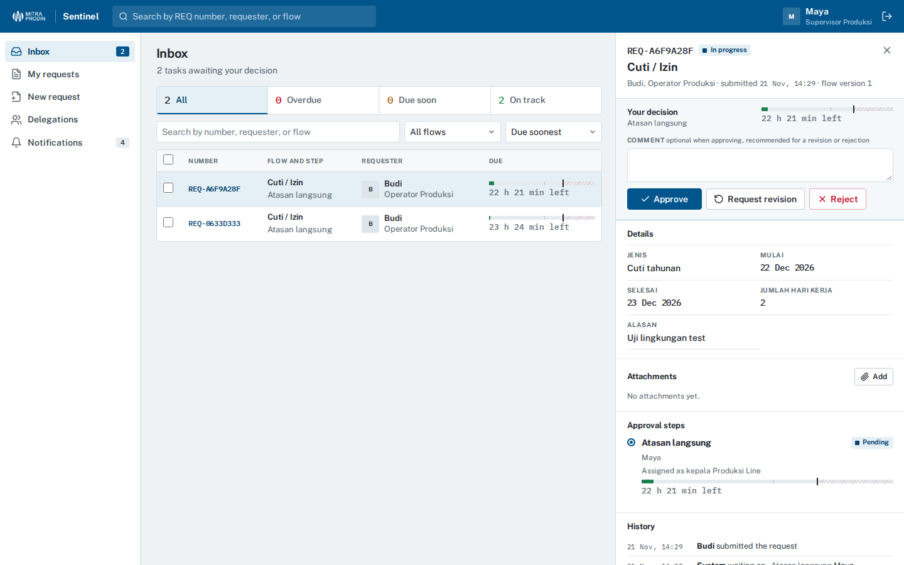
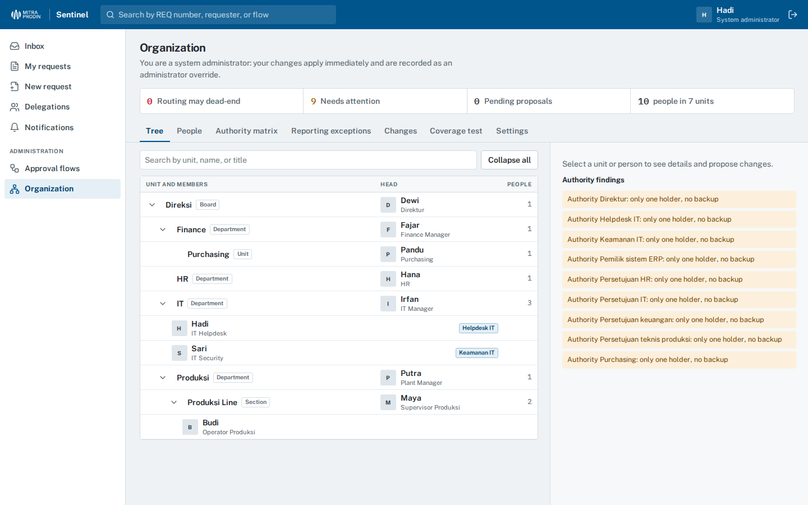
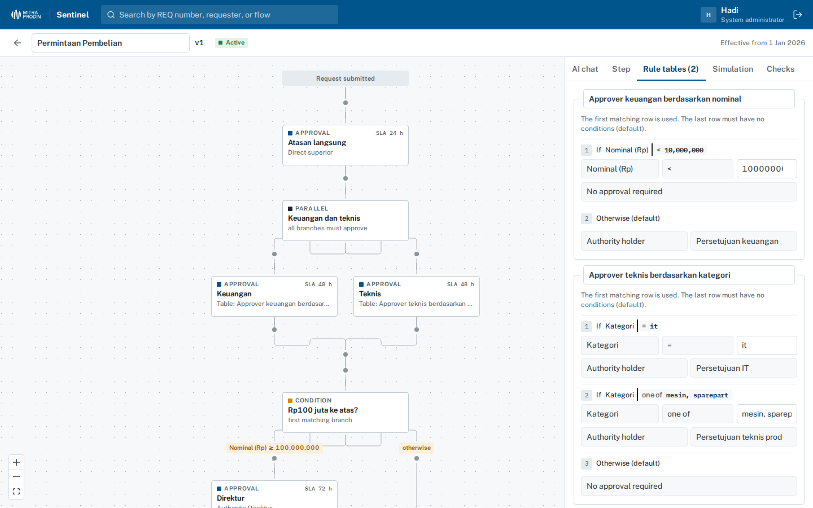

# Sentinel

[](https://github.com/alan-mp/workflow-sentinel/actions/workflows/ci.yml)

Sentinel is an approval-workflow web application that puts a company's approval rules in one place instead of in
every internal system. The people who own an SOP turn it into a working, versioned approval flow with help from an AI
drafter that cites the SOP for every rule. Approvers are computed from the organization structure, and every assignment and decision is recorded with its reason.

**Live demo:** https://workflow-sentinel-test.developer-24e.workers.dev

| Demo account (password `demo1234`) | Role |
|---|---|
| `budi@contoh.test` | Requester |
| `maya@contoh.test` | Approver (unit head) |
| `fajar@contoh.test` | Approver (finance authority) |
| `hana@contoh.test` | Process owner and organization owner |
| `hadi@contoh.test` | System administrator (can do everything) |

The demo runs on sample data. Demo flow and step names are in Indonesian because they are user-entered data.



## What it does
- **Requests and inbox.** Submit a request, follow where it is, and decide a queue of approvals with search, filters,
  SLA bands, and bulk approve. Works on desktop and phone.
- **AI request briefing and anomaly flags.** When a request is filed, the approver gets a short AI summary of what is
  asked and anything missing. Sentinel also checks the request against earlier ones (a purchase split to stay under an
  approval limit, an amount far above the usual, a duplicate) and shows the flags, explained by AI, to approvers only.
- **AI flow drafter.** Paste or upload an SOP and ask for a flow. The AI proposes steps and rule tables and attaches a
  quote from the SOP to each rule; quotes are checked against the SOP text, and anything not found is flagged. The AI
  can only edit a draft. It asks a question when the SOP is ambiguous instead of guessing.
- **Visual flow editor.** Diagram, step panel, rule tables, simulation ("who would this request go to?"), and
  validation that no path can finish without a human approval.
- **Organization master.** A unit tree with one head per unit, acting heads, escalation over vacancies, time-boxed
  reporting exceptions, and a separate authority matrix. A coverage test finds people whose approval path would dead-end.
- **Controls.** A requester can never approve their own request; flow and organization changes need a second person;
  the audit trail is append-only; active flow versions are immutable.
- **Integrations.** Other systems file requests through an API with a per-system key and are told the outcome by
  signed webhooks, so approval rules live in one place instead of in every application.
- **MCP server.** Every feature is also available to AI assistants at `/mcp` through OAuth, with exactly the
  signed-in user's permissions.




## Documentation
| Document | Contents |
|---|---|
| [docs/validation.md](docs/validation.md) | 7-step idea validation: verdict, measured evidence, owner interview, pilot design, risk register |
| [docs/PRD.md](docs/PRD.md) | One-page product requirements with acceptance criteria |
| [docs/spec.md](docs/spec.md) | Data model, interfaces, acceptance tests, deployment, revisions after review |
| [docs/architecture.md](docs/architecture.md) | Architecture diagram and design decisions |
| [CLAUDE.md](CLAUDE.md), [.cursorrules](.cursorrules) | Rules for AI coding assistants working in this repository |
| [apps/web/PRODUCT.md](apps/web/PRODUCT.md), [apps/web/DESIGN.md](apps/web/DESIGN.md) | Product context and design system (Indonesian) |

## Stack
TypeScript throughout. React 18 + Vite for the web app; Hono on Cloudflare Workers for the API; D1 (SQLite), R2, and KV
for storage; `json-rules-engine` for rule evaluation; Claude through Cloudflare AI Gateway for the drafter; the
Model Context Protocol SDK and Cloudflare's OAuth provider for the MCP server; Vitest for tests.

```
packages/engine   Pure domain logic: flow definitions, validation, routing, organization tree, SLA, simulation
apps/api          Cloudflare Worker: API, persistence, AI drafter, MCP server, OAuth consent, cron
apps/web          React single-page app
```

## Run locally
Requires Node.js 22 or later.

```bash
npm install
npm run db:setup     # create the local database with demo data
npm run dev          # http://localhost:8787
```

```bash
npm run typecheck    # TypeScript, all packages
npm test             # 107 unit and API tests
npm run build        # production build of the web app
```

The AI drafter is off locally because it needs the Cloudflare AI binding; everything else works offline.

## CI/CD
[`.github/workflows/ci.yml`](.github/workflows/ci.yml) runs on every push and pull request: dependency audit,
typecheck, all tests, and a production build, and keeps the built web app as an artifact. Deployment to the test
environment is a deliberate manual step (`npm run deploy:test`), so no cloud credentials are stored in GitHub.

Monitoring: Workers observability (logs and traces) is enabled, and AI Gateway records every AI request with its cost.

## Deploy manually
```bash
cd apps/api
npx wrangler d1 create sentinel --location apac          # copy the id into wrangler.jsonc
npx wrangler r2 bucket create sentinel-files
npx wrangler kv namespace create sentinel-oauth          # copy the id into wrangler.jsonc
npx wrangler d1 migrations apply sentinel --remote
cd ../.. && npm run deploy
```

The test environment deploys with `CLOUDFLARE_ACCOUNT_ID=<account id> npm run deploy:test`; the account is read from
the environment and is not written in the repository.

### AI without keys
The drafter reaches Claude through the Worker `AI` binding and a Cloudflare AI Gateway with Unified Billing, so the
Worker stores no provider key and no gateway token.

1. In the Cloudflare dashboard, create an AI Gateway and add credits under "Credits Available".
2. Add `"ai": { "binding": "AI" }` and set `AI_GATEWAY_ID` to the gateway name in `wrangler.jsonc` (see `env.test`), then deploy.

To use your own Anthropic key instead, leave `AI_GATEWAY_ID` empty, set `AI_GATEWAY_URL`, and store
`ANTHROPIC_API_KEY` with `wrangler secret put`.

### Integrations
An administrator creates an API client under **Integrations** and gets a key once. Another system then files a
request for an employee:

```bash
curl -X POST https://<host>/api/integrations/requests \
  -H "Authorization: Bearer sk_sentinel_..." -H "Content-Type: application/json" \
  -d '{"flowKey":"purchase","requesterEmail":"budi@contoh.test","externalRef":"PR-1042",
       "data":{"amount":1000000,"category":"atk","description":"Printer paper"},
       "callbackUrl":"https://erp.example.com/hooks/approval"}'
```

When the request is approved, rejected, or cancelled, Sentinel POSTs the outcome to the callback URL and to every
registered webhook, signed with `X-Sentinel-Signature`. The payload and the signature check are described in
[docs/spec.md](docs/spec.md).

### MCP
Connect an MCP client to `https://<host>/mcp`. From Claude Code:

```bash
claude mcp add --transport http sentinel https://workflow-sentinel-test.developer-24e.workers.dev/mcp
```

Then run `/mcp` to sign in. The tool list is in [`apps/api/src/mcp.ts`](apps/api/src/mcp.ts).

## Security
- No secrets in the repository; the demo password is sample data only.
- Sessions are HttpOnly, SameSite=Strict cookies; passwords are stored as PBKDF2 hashes.
- A request is visible only to its requester, approvers, and their delegates.
- The AI drafter never receives employee data, and its output passes the same validation as a human edit.
